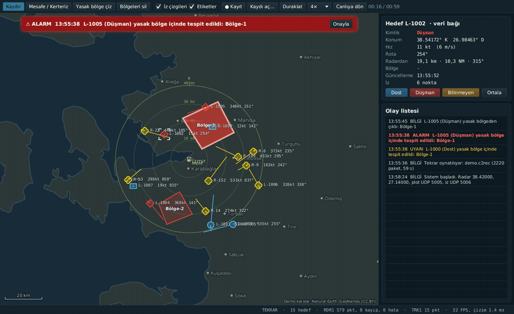
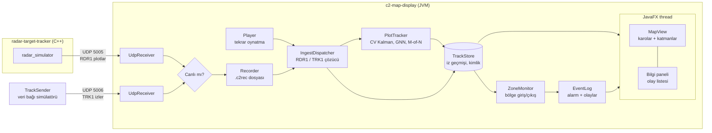

# C2 Map Display

[](https://github.com/mustafagulturk/c2-map-display/actions/workflows/ci.yml)


Radar simülatöründen gelen hedefleri gerçek zamanlı olarak **çevrimdışı bir harita** üzerinde gösteren, Java 21 ve JavaFX ile yazılmış bir **komuta kontrol operatör ekranı**. [radar-target-tracker](https://github.com/mustafagulturk/radar-target-tracker) projesindeki `radar_simulator`'ın UDP ile yayınladığı ham radar ölçümlerini doğrudan dinler, kendi izleyicisiyle iz oluşturur ve iki proje birlikte küçük bir sensör → C2 zinciri gibi çalışır.

*A Java 21 / JavaFX command-and-control operator display: offline slippy map, live UDP radar plots tracked with a Kalman filter, APP-6 style friend/hostile/unknown symbology with trails and velocity leaders, restricted-zone alarms with an event log, range/bearing tool, track info panel, and record/replay of the raw feed. Gradle, JUnit 5, GitHub Actions.*



*Kayıttan 4× hızda tekrar oynatma: `radar_simulator`'dan gelen radar izleri (R-…, sarı = bilinmeyen) ve veri bağından gelen kimlikli izler (L-…). Bir hedef Bölge-1'e girince alarm bandı açılıyor ve olay listesine kayıt düşüyor.*

## Özellikler

1. **Çevrimdışı harita:** Standart OpenStreetMap `{z}/{x}/{y}.png` karo dizininden okur, internet gerekmez. Fare tekerleğiyle imleç etrafında yumuşak yakınlaştırma, sürükleyerek kaydırma, eksik karoda üst seviye karoyu büyütme, hiç karo yoksa enlem/boylam ızgarası. Ölçek çubuğu ve imleç koordinatı.
2. **UDP hedefleri ve semboloji:** `radar_simulator`'ın RDR1 plot paketleri (UDP 5005) Kalman filtreli bir izleyiciden geçer; kimlik taşıyan TRK1 iz mesajları (UDP 5006) doğrudan gösterilir. Dost (mavi daire/dikdörtgen), düşman (kırmızı baklava), bilinmeyen (sarı yonca) APP-6 tarzı semboller; solan iz çizgisi, 60 saniyelik hız vektörü, etikette hız (kt) ve rota.
3. **Yasak bölge ve alarm:** Haritaya çokgen çizilir; bir hedef girdiğinde kırmızı alarm bandı, sesli uyarı ve olay listesine kayıt. Çıkışlar da kayda geçer, ihlal olan bölge yanıp söner. Bölgeler diske kaydedilir.
4. **Mesafe ve kerteriz aracı:** İki nokta arası büyük daire mesafesi (km ve deniz mili), gerçek kerteriz ve ters kerteriz.
5. **Bilgi paneli:** Hedefe tıklayınca konum, hız, rota, radardan mesafe/kerteriz, bulunduğu yasak bölge ve iz uzunluğu. Operatör hedefi dost/düşman/bilinmeyen olarak sınıflandırabilir.
6. **Kayıt ve tekrar oynatma:** Gelen ham UDP verisi zaman damgasıyla dosyaya yazılır; tekrar oynatmada aynı çözücü ve izleyiciden geçtiği için ekran birebir yeniden oluşur. 0,5×–16× hız, duraklat, canlıya dön.
7. **Kalite:** 140+ JUnit 5 testi, `-Xlint:all -Werror`, Linux/Windows/macOS üzerinde GitHub Actions CI.

## Mimari



Ağ alıcıları ayrı daemon thread'lerde çalışır; çözme, izleme ve bölge kontrolü alıcı thread'inde biter, arayüz yalnızca `TrackStore`'un değişmez anlık görüntüsünü (`List<TrackSnapshot>`) her karede okur. Böylece ağ trafiği hiçbir zaman çizimi beklemez, çizim de kilit tutmaz. Kayıt ve tekrar oynatma aynı `DatagramSink` arayüzünü kullandığından tekrar oynatılan veri canlı veriyle tamamen aynı kod yolundan geçer.

| Paket | Sorumluluk |
| --- | --- |
| `geo` | `GeoPoint`, büyük daire mesafe/kerteriz, yerel doğu/kuzey düzlemi, Web Mercator |
| `map` | Karo deposu (LRU önbellek, asenkron yükleme), `MapView` (kaydırma, yakınlaştırma, katmanlar), kare istatistikleri |
| `net` | RDR1 ve TRK1 ikili formatları, UDP alıcı, `IngestDispatcher` |
| `track` | `PlotTracker` (Kalman izleyici), `TrackStore`, radar konumu, kimlik |
| `zone` | Yasak bölge çokgeni, giriş/çıkış izleme, bölge dosyası |
| `event` | Sınırlı, thread-safe olay günlüğü ve alarm kancaları |
| `measure` | Mesafe/kerteriz hesabı ve Türkçe biçimlendirme |
| `record` | Kayıt dosyası formatı, `Recorder`, `Player` |
| `ui` | JavaFX uygulaması, semboloji, harita katmanları, araçlar, paneller |
| `tools` | Test göndericileri, demo karo üreteci, OSM karo indirici, ölçüm aracı |

### İzleyici

`radar_simulator` hazır iz değil, ham ölçüm (menzil, kerteriz, genlik) ve her taramada ~20 sahte alarm gönderir; kimlik (IFF) bilgisi yoktur. `PlotTracker`, C++ projesindeki `TrackManager`'ın Java karşılığıdır: 4 durumlu sabit hız Kalman filtresi, χ² kapılama, açgözlü global en yakın komşu eşleştirme, 3 isabette iz doğrulama ve yalnızca anten hedefin yönünü gerçekten taradığında sayılan kaçırma. Clutter'dan sahte iz çıkmaması için geçici izlerde daha dar kapı ve 600 m/s hız sınırı kullanılır. Radar izleri **Bilinmeyen** olarak başlar; operatör bilgi panelinden sınıflandırır.

### Paket formatları

**RDR1** (radar_simulator → UDP 5005, big-endian; ayrıntı: [radar-target-tracker](https://github.com/mustafagulturk/radar-target-tracker#udp-paket-formatı))

| Ofset | Boyut | Alan |
| --- | --- | --- |
| 0 | 4 | magic `"RDR1"` |
| 4 | 1 | sürüm (1) |
| 6 | 2 | plot sayısı N |
| 8 | 4 | sıra numarası |
| 12 | 8 | zaman damgası (µs) |
| 20 / 24 | 4 + 4 | sektör başı / sonu (float32, rad) |
| 28 | 12·N | plot: menzil (m), kerteriz (rad, kuzeyden saat yönü), genlik (dB) |

**TRK1** (veri bağı izleri → UDP 5006, big-endian, datagram başına en çok 46 iz)

| Ofset | Boyut | Alan |
| --- | --- | --- |
| 0 | 4 | magic `"TRK1"` |
| 4 | 1 | sürüm (1) |
| 6 | 2 | iz sayısı N |
| 8 | 4 | sıra numarası |
| 12 | 8 | geçerlilik zamanı (epoch ms) |
| 20 | 30·N | iz: id u32, kimlik u8 (0 dost, 1 düşman, 2 bilinmeyen), bayrak u8 (bit 0 = iz bitti), enlem f64, boylam f64, hız f32 (m/s), rota f32 (°) |

**Kayıt dosyası** (`.c2rec`): 16 baytlık başlık (`"C2REC1"`, sürüm, başlangıç zamanı), ardından her datagram için geliş zamanı (i64 ms), kanal (u8), uzunluk (u16) ve ham bayt. Yarım kalan son kayıt (çökme, elektrik kesintisi) sessizce atlanır.

## Derleme

Gereksinim: JDK 21. Gradle wrapper ve JavaFX bağımlılıkları otomatik iner.

```bash
git clone https://github.com/mustafagulturk/c2-map-display.git
cd c2-map-display
./gradlew build          # derle + 140+ test
./gradlew tileGenerator  # çevrimdışı demo karoları ~/.c2map/tiles altına üret (~4 sn)
./gradlew run            # operatör ekranını aç
```

### Harita karoları

Uygulama karoları `~/.c2map/tiles/{z}/{x}/{y}.png` dizininden okur (`-Dc2map.tiles=<dizin>` veya `C2MAP_TILES` ile değiştirilebilir). İki seçenek:

- **Demo karolar (internetsiz):** `./gradlew tileGenerator` depodaki Natural Earth kıyı/sınır/göl/nehir verisinden ve GeoNames şehir listesinden İzmir ve Ege çevresi için zoom 4–11 karolarını çizer. Farklı bölge: `./gradlew tileGenerator --args="--bbox 39.4,32.2,40.4,33.5 --zoom 4-11"`.
- **Gerçek OSM karoları:** İnternetli bir makinede `./gradlew tileDownloader --args="--bbox 38.0,26.6,38.9,27.7 --zoom 6-13"` küçük bir bölgeyi indirir, sonra dizin başka makineye kopyalanıp tamamen çevrimdışı kullanılabilir. Araç [OSM karo kullanım politikasına](https://operations.osmfoundation.org/policies/tiles/) uyar (saniyede en çok 2 istek, tanımlayıcı User-Agent, 5000 karo üstünü reddeder). Toplu indirme için kendi karo sunucunuzu veya ticari bir sağlayıcıyı `--url` ile kullanın.

## Radarla birlikte çalıştırma

```bash
# 1) Radar simülatörünü derle (bir kez; GUI'siz derleme yeterli)
git clone https://github.com/mustafagulturk/radar-target-tracker.git
cmake -S radar-target-tracker -B rtt-build -DCMAKE_BUILD_TYPE=Release -DRADAR_BUILD_GUI=OFF
cmake --build rtt-build

# 2) Operatör ekranı (UDP 5005 ve 5006'yı dinler)
./gradlew run

# 3) Radar simülatörü, ayrı terminalde
./rtt-build/radar_simulator --targets 6 --clutter 20

# 4) (İsteğe bağlı) Kimlikli veri bağı izleri: dost/düşman/bilinmeyen karışımı
./gradlew trackSender --args="--tracks 8 --radius-km 45"
```

İlk izler, 3 tarama (yaklaşık 6 saniye) sonra doğrulanıp haritada belirir. C++ derlemek istemiyorsanız aynı formatı ve senaryoyu üreten Java göndericisi var: `./gradlew plotSender`.

Radar başka bir yerdeyse konumunu verin; plotlar bu noktaya göre haritaya yerleştirilir:

```bash
./gradlew run --args="--site 39.93,32.85 --range-km 40"
```

| Seçenek | Varsayılan | Açıklama |
| --- | --- | --- |
| `--site <enlem,boylam>` | `38.42,27.14` (İzmir) | Radar konumu |
| `--range-km <km>` | `40` | Radar menzili (menzil halkaları) |
| `--plot-port` / `--track-port` | `5005` / `5006` | RDR1 ve TRK1 UDP portları |
| `--zones <dosya>` | `~/.c2map/zones.tsv` | Yasak bölge dosyası |
| `--recordings <dizin>` | `~/.c2map/recordings` | Kayıt dizini |
| `--replay <dosya>` `--speed <x>` | | Açılışta kaydı oynat |
| `--zoom <z>` | `9.5` | Başlangıç yakınlaştırması |

### Kullanım

| İşlem | Nasıl |
| --- | --- |
| Kaydır / yakınlaştır | Sol tuşla sürükle (araç seçiliyken orta/sağ tuş), tekerlek, `+` `-` ve ok tuşları |
| Hedef bilgisi | Hedefe tıkla; panelde **Dost / Düşman / Bilinmeyen** ile sınıflandır, **Ortala** ile haritayı hedefe getir |
| Yasak bölge | **Yasak bölge çiz** → köşelere tıkla → çift tıkla veya `Enter`. `Esc` iptal, sağ tık son köşeyi ya da mevcut bölgeyi siler |
| Mesafe / kerteriz | **Mesafe / Kerteriz** → basılı tutup sürükle ya da iki noktaya tıkla, `Esc` temizler |
| Alarm | Kırmızı bandı **Onayla** ile kapat; olay listesinde bir satıra tıklamak ilgili hedefi seçer |
| Kayıt | **● Kayıt** başlatır/durdurur (`~/.c2map/recordings/kayit-*.c2rec`) |
| Tekrar oynatma | **Kaydı aç…** → hız seç, **Duraklat/Oynat**, **Canlıya dön** |

## Ölçüm sonuçları

### Çizim: kaç hedefte akıcı?

`scripts/bench.sh`, `TrackSender` ile 60 km yarıçapta N hedefi saniyede bir güncelleyip uygulamayı `--bench` modunda 20 saniye ölçer (5 sn ısınma sonrası). Hedeflerin hepsi ekranda; iz çizgileri, hız vektörleri ve etiketler açık (300 hedefin üstünde etiketler otomatik gizlenir). Pencere 1440×880.

Ölçüm ortamı bilinçli olarak **en kötü durum**: GPU'suz bulut sunucusu, 4 vCPU Intel Xeon 2.1 GHz, Xvfb, JavaFX **yazılım** rasterleştiricisi (`-Dprism.order=sw`). Boş harita bile bu ortamda ~52 FPS'te kalıyor.

| Hedef sayısı | FPS | Kare hazırlama ort. (ms) | Kare hazırlama p99 (ms) | Heap (MB) |
| ---: | ---: | ---: | ---: | ---: |
| 0 | 52 | 0,15 | 0,49 | 92 |
| 100 | 45 | 0,35 | 0,62 | 50 |
| 500 | 32 | 0,92 | 1,71 | 78 |
| 1000 | 22 | 1,85 | 4,27 | 89 |
| 2000 | 18 | 3,42 | 7,45 | 143 |
| 5000 | 9 | 7,86 | 14,86 | 139 |

Nasıl okunur:

- **FPS** ekrana gerçekten çıkan kare sayısıdır; yazılım rasterleştiricide sınırlayıcı olan piksel doldurma maliyetidir. Bu ortamda **~500 hedefe kadar 30 FPS üstünde** akıcı, 1000–2000 hedefte kullanılabilir (~20 FPS) kalıyor.
- **Kare hazırlama** süresi, FX thread'inde tüm katmanların çizim komutlarını üretmek için harcanan süredir ve GPU'dan bağımsızdır. 5000 hedefte bile 8 ms (bir 60 Hz karesinin yarısı); yani GPU hızlandırmalı bir masaüstünde darboğaz FX thread'i değil, rasterleştiricidir.
- Kendi makinenizde (GPU ile) ölçmek için: `scripts/bench.sh 100 500 1000 2000 5000`, sonuçlar `build/bench.txt` dosyasına eklenir.

### Veri işleme: datagram başına maliyet

`./gradlew ingestBenchmark` ağı ve arayüzü devre dışı bırakıp bir datagramın çözülme + izleme + `TrackStore` güncelleme + 4 yasak bölge kontrolü süresini ölçer (aynı makine, tek thread, JIT ısındıktan sonra).

| Durum | Datagram | Ort. (µs) | p99 (µs) | Kapasite |
| --- | ---: | ---: | ---: | ---: |
| Radar plot, 6 hedef + 20 clutter/tur (6 iz) | 18/s | 6,9 | 38,6 | tek çekirdeğin %0,01'i |
| Radar plot, 30 hedef + 20 clutter/tur (29 iz) | 18/s | 14,8 | 68,1 | tek çekirdeğin %0,03'ü |
| Radar plot, 100 hedef + 20 clutter/tur (94 iz) | 18/s | 31,3 | 116,4 | tek çekirdeğin %0,06'sı |
| Veri bağı, 1000 iz × 1 Hz | 22/s | 66,1 | 151,9 | tek çekirdeğin %0,15'i |
| Veri bağı, 5000 iz × 1 Hz | 109/s | 88,3 | 241,4 | tek çekirdeğin %0,96'sı |

Gerçek UDP üzerinden uçtan uca denemede 5000 izi 2 Hz'de (saniyede ~10 000 iz güncellemesi) gönderen `TrackSender` ile `radar_simulator` aynı anda çalışırken **0 kayıp paket, 0 çözme hatası** görüldü.

## Testler

`src/test` altındaki 140+ JUnit 5 testi (~10 sn) şunları kapsar:

- Jeodezi ve Web Mercator: mesafe/kerteriz, ileri/geri dönüşümler, karo numaraları, antimeridyen
- Karo önbelleği: LRU, eksik karoyu hatırlama, asenkron yükleme; ölçek çubuğu, kare istatistikleri, TopoJSON çözücü
- RDR1/TRK1: elle oluşturulmuş bayt bayt fikstür, gidiş-dönüş, bozuk/kısa/fazla bayt/NaN reddi, paket bölme; gerçek loopback UDP soketi
- İzleyici: doğrusal hedefler + clutter senaryosunda iz doğrulama, kesişen hedeflerde ID değişmemesi, kaybolan hedefin silinmesi, sahte iz sınırı
- `TrackStore`: iz geçmişi, zaman aşımı, operatör kimlik ataması, dinleyiciler
- Yasak bölge: dışbükey/içbükey çokgenler, köşeden geçen ışın, giriş/çıkış/tekrar giriş, bölge eklenince içerideki hedef, eşzamanlı güncellemeler, dosyaya kaydetme
- Kayıt/oynatma: 16× hızda bayt bayt aynı gidiş-dönüş, zamanlama ölçeği, duraklat/devam/hız değişimi, kesik dosya, 4 thread'le eşzamanlı kayıt
- Mesafe/kerteriz biçimlendirme, komut satırı seçenekleri

```bash
./gradlew test
```

## Proje yapısı

```
src/main/java/io/github/mustafagulturk/c2map/
  geo/ map/ net/ track/ zone/ event/ measure/ record/ ui/ tools/
src/main/resources/naturalearth/   Demo karolar için vektör veri (1,4 MB, gzip)
src/test/java/...                  JUnit 5 testleri
scripts/bench.sh                   Çizim performansı ölçümü
.github/workflows/ci.yml           CI: Linux, Windows, macOS
```

## Geliştirme fikirleri

- ASTERIX CAT-048/062 girişi ve çoklu radar füzyonu
- Bölge türleri (uçuşa yasak, uyarı bölgesi), irtifa katmanları, zaman pencereli bölgeler
- En yakın yaklaşma noktası (CPA) ve tehdit değerlendirmesi
- Vektör karo (MBTiles) desteği

## Lisans ve veri kaynakları

Kod [MIT](LICENSE) © 2026 Mustafa Gulturk.

Demo karo verisi: [Natural Earth](https://www.naturalearthdata.com/) (kamu malı, `world-atlas` ve `sane-topojson` paketleri üzerinden), şehir adları [GeoNames](https://www.geonames.org/) (CC BY 4.0). OSM karoları kullanıldığında harita verisi © [OpenStreetMap](https://www.openstreetmap.org/copyright) katkıda bulunanlar (ODbL). Ayrıntılar: `src/main/resources/naturalearth/SOURCES.txt`.
